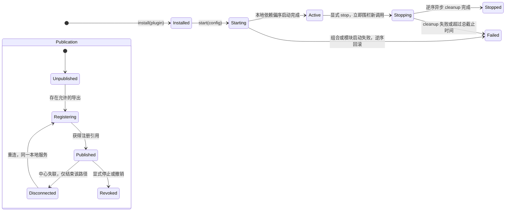

# S2：插件运行时与能力组合契约

状态：S2 已实现；MVP-P2 将默认 Instance 迁移为本地业务与发布分离，本文描述迁移后的语义。依据：[私有运行契约](private-runtime.md)、[目标架构](../design/2026-10-17-conex-architecture.md) 与 [S1 契约](s1-capabilities.md)。历史证据见 [S2 验证记录](../verification/s2-plugins.md)，当前自治证据见 [P2 验证记录](../verification/private-runtime-p2.md)。

## 1. 决定与非目标

**决定**

- 插件是 SDK 侧的组合单元，运行在受信进程内。不做动态代码加载、不做清单执行加载器、不把 DI/类型系统当沙箱（架构 §7 的既有边界）。
- Instance 拥有本地模块，不以连接存活为业务租约。独立 SDK Instance 管理自己的发布连接；Node 中多个应用共享一个节点 Publication/连接，各应用只持可撤销发布引用，停止一个应用不能关闭共享连接。相同 node 身份不能各开一条连接冒充独立应用：S1 会把后连接视为节点换代。
- 依赖分两类：**本地依赖**（同实例内模块，组合期解析为进程内句柄，不经网络）与**显式远程绑定**（实例配置把依赖名固定映射到另一个实例已发布模块的 `ModuleRef`，经中心调用/订阅）。
- 缺失依赖、循环依赖在**启动前**拒绝；拒绝时零发布、零连接残留。
- 显式停止 = 立即围栏新增调用 + 逆拓扑撤销发布/关闭订阅与消费者/执行模块异步 cleanup。仅关闭自己拥有的连接和业务资源；借用的节点连接与外部进程不在释放范围。
- 派生模块复用 S1 发布/消费边界（同 contract_id、自有 `(spaceId, providerEndpointId)`、独立 revision 序列），不新增路由或 wire 字段。

**非目标**

- 不做插件打包/安装器/市场；"已安装"指进程内 `install(plugin)`。
- 不做透明重绑定；`ModuleRef` 在连接代次失效后绑定显式失败，由上层重新配置。
- 不新增 wire 协议、错误码、proto 字段；组合期错误是 SDK 本地类型化错误，不过网。
- 不做跨进程服务发现协议；远程绑定来源仍是 S1 `list_modules` 或静态配置。

## 2. 原语与命名

| 原语 | 语义 | S1 对应 |
|---|---|---|
| Plugin（插件类） | `id` + 工厂：`config → 模块图声明`。进程内安装一次 | 无 |
| Instance（本地实例） | 一次插件实例化，拥有若干模块；业务与发布状态独立 | 可经独立或 Node 共享连接发布 |
| Module（模块） | 本地模块名、服务和 cleanup；允许的导出才注册到中心 | 可选 `ModuleRequest` |
| LocalDep | 同实例内模块名 → 已启动模块暴露的服务句柄 | 无 |
| RemoteBinding | 依赖名 → `ModuleRef`（固定注册绑定） | `invoke/subscribe` 的目标 |
| Derived module | 其状态 handler 订阅上游模块状态并按同一契约再发布的模块 | state handler + subscribe |

模块图只由**本地依赖**构成启动偏序；远程绑定不参与启动排序（它是运行期推/拉，不是构造参数）。

## 3. 生命周期

- **组合期**（发任何网络帧之前）：工厂产出模块图 → 本地图校验（缺失节点、环、重复模块名）→ 远程绑定清单校验（每个待绑定依赖有 `ModuleRef`）。任一失败即 `Failed`，类型化错误带定位（哪个模块、哪个依赖）。
- **启动期**：按本地依赖偏序逐模块 `start`；无显式必需远程依赖时，中心不可达也能进入 `Active`。发布在独立任务中进行，`start` 返回不代表已发布；读取 `module`/`module_ref` 前须等待 `Published`。模块启动失败按逆序 cleanup，保留原始错误和清理诊断。
- **停止期**：默认总截止时间30秒，后续并发 stop 只能缩短、不能延长；全部等待者得到同一终态。模块 cleanup 只执行一次，失败/超时明确进入 `Failed`（Rust `StopOutcome::Failed`、TS rejected promise），不假报已释放。Drop 仅作同步取消兜底。
- **断线期**：本地服务、generation 和 nodeRuntimeEpoch 不变；重连只重新发布并生成新 registrationId。旧调用/订阅不恢复，不重放副作用；显式 `RemoteBinding` 仍固定旧引用，过期明确失败，不透明重绑。

## 4. 依赖解析与拒绝

- **缺失依赖**：本地依赖名不在图内，或远程绑定缺 `ModuleRef` → `missing_dependency { module, dependency }`，实例不启动。
- **循环依赖**：本地图存在环 → `circular_dependency { cycle: [module...] }`，实例不启动。环检测在组合期，先于任何网络副作用。
- **重复声明**：同实例内模块名重复 → 组合期拒绝。
- **远程绑定失效**：`ModuleRef` 指向的注册已撤销/换代 → 沿用 S1 调用/订阅错误路径（`stale`/`-32013` 族），组合期不预验远端存在性（避免发现与使用间的 TOCTOU 假象）。
- 错误是 SDK 本地类型化错误（TS discriminated union / Rust enum），不复用 wire `Error`，不发明新错误码。

## 5. 本地依赖注入

- 模块 `start(ctx)` 拿到 `ModuleContext`：`deps.local(name) → 上游模块 start 时返回的服务句柄`；`deps.remote(name) → 绑定到该依赖名 ModuleRef 的消费者句柄`（invoke/cancel/subscribe，带 S1 已验证语义）。
- 本地调用是进程内直接函数调用，**不伪装成远程语义**：没有 request id、没有超时/取消信封；handler 的取消/上下文语义只在真正过网的路径上存在。
- 服务句柄形状由插件作者定义，SDK 不做接口生成；契约类型仍用于 wire 发布校验。

## 6. 派生模块

- 派生模块是普通模块：同 contract_id、自有 4 元组、自己的 revision 序列（不继承上游 revision 值）。
- 上游可以是本地依赖（进程内观察者）或远程绑定（S1 subscribe）。派生模块在拿到上游首个快照**之前**不得对外发布自己的状态订阅开放（先快照后更新的语义在自己的边界上独立成立）。
- 跨语言消费：契约 A07 要求 Rust 实例的派生模块可被 TS 消费者 read/subscribe，反之亦然；派生不引入语言相关的 wire 行为。

## 7. 停止释放的真实性

- 停止后：本地新调用立即拒绝；中心可达时逆序撤销注册、结束订阅；中心失联时由连接代次清理目录。真实自有任务/观察者需在 cleanup 中取消并等待；未完成资源必须留诊断/核对记录。
- 多实例隔离：停 A 不影响 B 的任何运行中调用、订阅或注册。
- 验收以真实两实例进程观察，不以单实例 mock 代替。

## 8. 验收场景

| 编号 | 场景 | 覆盖 |
|---|---|---|
| S2-A01 | 一个插件类两个实例并存，独立 count/revision，互不串扰 | 实例模型、多接入 |
| S2-A02 | 本地依赖：实例内派生模块消费同实例模块（进程内句柄，零网络帧） | 本地 DI |
| S2-A03 | 显式远程绑定：A 实例模块绑定 B 实例模块 ModuleRef，跨实例消费 | 显式远程依赖 |
| S2-A04 | 缺失依赖：绑定/本地图缺依赖 → 启动拒绝、零发布、零连接 | 拒绝路径 |
| S2-A05 | 循环依赖：本地图成环 → 组合期拒绝 | 拒绝路径 |
| S2-A06 | 停止实例：unpublish、订阅 end、handler abort、无残留；另一实例不受影响 | 停止释放 |
| S2-A07 | 派生模块跨语言：Rust 派生模块被 TS 消费（read+subscribe），TS 派生被 Rust 消费 | 派生再发布 |
| S2-A08 | 已停止实例不复活；中心断线不销毁未停止的业务，重连仅换注册；旧 ModuleRef 显式失效 | S2 停止/新实例测试 + 双 SDK 重连回归 + P2 实际中心重启 |

## 9. 当前实现证据与迁移边界

- S2 历史三进程证据在 `docs/verification/s2-plugins.md`；P2 自治迁移与所有权证据在 `docs/verification/private-runtime-p2.md`。历史“断开即销毁业务”不再是默认行为。
- 复用不改：S1 握手、发布/撤销、调用/取消、订阅语义、静态批准、代次清理全部保持。
- 旧 P0 `Registry`/`Manifest`（conex-core registry、manifest.proto）不作为 S2 插件模型实现载体；其表驱动冲突拒绝思想已由 S1 host registry 承接。

## 10. 评审与来源

需要评审的取舍：

1. 生命周期归属已由 P2 决定：本地 Instance 拥有业务，Node 拥有共享 Publication；独立 SDK Instance 仍可自行发布，但不能把相同节点身份的多条连接当应用隔离。
2. 远程绑定组合期不预验远端存在性（备选：启动时 list 确认；代价是 TOCTOU 假绿）。
3. 本地 DI 不复制远程信封（备选：统一调用语义；代价是把进程内调用变成伪网络栈）。
