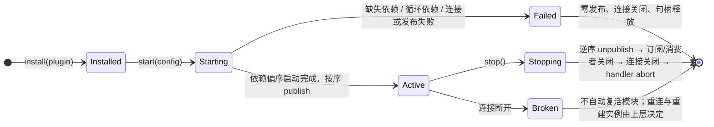

# S2：插件运行时与能力组合契约

状态：待评审、未实施。执行状态在 Paca conex 项目维护。依据：[目标架构](../design/2026-10-17-conex-architecture.md) §11 S2、[迁移盘点](../design/2026-10-17-conex-migration-assessment.md)、[S1 契约](s1-capabilities.md)。

## 1. 决定与非目标

**决定**

- 插件是 SDK 侧的组合单元，运行在受信进程内。不做动态代码加载、不做清单执行加载器、不把 DI/类型系统当沙箱（架构 §7 的既有边界）。
- 一个接入实例对应一条 SDK 连接（Rust `Client`、TS `ConexWsClient`/`CapabilitySession`）。同一插件类可创建多个实例，每实例独立连接、独立模块注册、独立状态序列。中心零改动。
- 依赖分两类：**本地依赖**（同实例内模块，组合期解析为进程内句柄，不经网络）与**显式远程绑定**（实例配置把依赖名固定映射到另一个实例已发布模块的 `ModuleRef`，经中心调用/订阅）。
- 缺失依赖、循环依赖在**启动前**拒绝；拒绝时零发布、零连接残留。
- 停止实例 = 逆拓扑序撤销发布 + 关闭订阅与消费者 + 关闭连接 + abort 全部 handler。中心侧由 S1 代次清理兜底。
- 派生模块复用 S1 发布/消费边界（同 contract_id、自有 `(spaceId, providerEndpointId)`、独立 revision 序列），不新增路由或 wire 字段。

**非目标**

- 不做插件打包/安装器/市场；"已安装"指进程内 `install(plugin)`。
- 不做透明重绑定；`ModuleRef` 在连接代次失效后绑定显式失败，由上层重新配置。
- 不新增 wire 协议、错误码、proto 字段；组合期错误是 SDK 本地类型化错误，不过网。
- 不做跨进程服务发现协议；远程绑定来源仍是 S1 `list_modules` 或静态配置。

## 2. 原语与命名

| 原语 | 语义 | S1 对应 |
|---|---|---|
| Plugin（插件类） | `id` + 工厂：`config → 模块图声明`。进程内安装一次 | 无 |
| Instance（接入实例） | 一次插件实例化：一条连接 + 若干模块。有实例 id，可启动/停止 | 一条 WSS 连接 |
| Module（模块） | 实例内以插件声明的模块名为键；发布为中心侧 4 元组注册 | `ModuleRequest` |
| LocalDep | 同实例内模块名 → 已启动模块暴露的服务句柄 | 无 |
| RemoteBinding | 依赖名 → `ModuleRef`（固定注册绑定） | `invoke/subscribe` 的目标 |
| Derived module | 其状态 handler 订阅上游模块状态并按同一契约再发布的模块 | state handler + subscribe |

模块图只由**本地依赖**构成启动偏序；远程绑定不参与启动排序（它是运行期推/拉，不是构造参数）。

## 3. 生命周期

- **组合期**（发任何网络帧之前）：工厂产出模块图 → 本地图校验（缺失节点、环、重复模块名）→ 远程绑定清单校验（每个待绑定依赖有 `ModuleRef`）。任一失败即 `Failed`，类型化错误带定位（哪个模块、哪个依赖）。
- **启动期**：按本地依赖偏序（Kahn）逐模块 `start`，模块 start 完成才启动依赖它的下游；全部启动后按 S1 语义 `publish`。发布中途失败：已发布者逆序撤销（补齐停止语义），实例落 `Failed`。
- **停止期**：`stop()` 幂等且并发安全（二次 stop 返回同一终态）；逆拓扑序 unpublish → 关闭本实例发起的订阅/消费者 → abort 仍在跑的 handler 并等待 → 关闭连接。停止是唯一的资源释放路径；连接意外断开（`Broken`）走同一清理但不再重连。
- S1 的"调用与订阅不自动复活"在实例层保持：实例重建 = 新实例新代次，旧 `ModuleRef` 失效。

## 4. 依赖解析与拒绝

- **缺失依赖**：本地依赖名不在图内，或远程绑定缺 `ModuleRef` → `missing_dependency { module, dependency }`，实例不启动。
- **循环依赖**：本地图存在环 → `circular_dependency { cycle: [module...] }`，实例不启动。环检测在组合期，先于任何网络副作用。
- **重复声明**：同实例内模块名重复 → 组合期拒绝。
- **远程绑定失效**：`ModuleRef` 指向的注册已撤销/换代 → 沿用 S1 调用/订阅错误路径（`stale`/`-32013` 族），组合期不预验远端存在性（避免发现与使用间的 TOCTOU 假象）。
- 错误是 SDK 本地类型化错误（TS discriminated union / Rust enum），不复用 wire `Error`，不发明新错误码。

## 5. 本地依赖注入

- 模块 `start(ctx)` 拿到 `ModuleContext`：`deps.local(name) → 上游模块 start 时返回的服务句柄`；`deps.remote(name) → 绑定到该依赖名 ModuleRef 的消费者句柄`（invoke/cancel/subscribe，带 S1 已验证语义）。
- 本地调用是进程内直接函数调用，**不伪装成远程语义**：没有 request id、没有超时/取消信封；handler 的取消/上下文语义只在真正过网的路径上存在。
- 服务句柄形状由插件作者定义，SDK 不做接口生成；契约类型仍用于 wire 发布校验。

## 6. 派生模块

- 派生模块是普通模块：同 contract_id、自有 4 元组、自己的 revision 序列（不继承上游 revision 值）。
- 上游可以是本地依赖（进程内观察者）或远程绑定（S1 subscribe）。派生模块在拿到上游首个快照**之前**不得对外发布自己的状态订阅开放（先快照后更新的语义在自己的边界上独立成立）。
- 跨语言消费：契约 A07 要求 Rust 实例的派生模块可被 TS 消费者 read/subscribe，反之亦然；派生不引入语言相关的 wire 行为。

## 7. 停止释放的真实性

- 停止后：模块不可被发现（list 无）、调用得到 S1 未注册错误、活动订阅收到 end、本实例无残留任务/观察者。
- 多实例隔离：停 A 不影响 B 的任何运行中调用、订阅或注册。
- 验收以真实两实例进程观察，不以单实例 mock 代替。

## 8. 验收场景

| 编号 | 场景 | 覆盖 |
|---|---|---|
| S2-A01 | 一个插件类两个实例并存，独立 count/revision，互不串扰 | 实例模型、多接入 |
| S2-A02 | 本地依赖：实例内派生模块消费同实例模块（进程内句柄，零网络帧） | 本地 DI |
| S2-A03 | 显式远程绑定：A 实例模块绑定 B 实例模块 ModuleRef，跨实例消费 | 显式远程依赖 |
| S2-A04 | 缺失依赖：绑定/本地图缺依赖 → 启动拒绝、零发布、零连接 | 拒绝路径 |
| S2-A05 | 循环依赖：本地图成环 → 组合期拒绝 | 拒绝路径 |
| S2-A06 | 停止实例：unpublish、订阅 end、handler abort、无残留；另一实例不受影响 | 停止释放 |
| S2-A07 | 派生模块跨语言：Rust 派生模块被 TS 消费（read+subscribe），TS 派生被 Rust 消费 | 派生再发布 |
| S2-A08 | 断开的实例不自动复活模块；新实例取得新代次，旧 ModuleRef 显式失效 | 与 S1 语义接续 |

## 9. 当前实现证据与迁移边界

- 本文为契约，截至撰写日无对应实现；实现证据在 `docs/verification/s2-plugins.md` 回填。
- 复用不改：S1 握手、发布/撤销、调用/取消、订阅语义、静态批准、代次清理全部保持。
- 旧 P0 `Registry`/`Manifest`（conex-core registry、manifest.proto）不作为 S2 插件模型实现载体；其表驱动冲突拒绝思想已由 S1 host registry 承接。

## 10. 评审与来源

需要评审的取舍：

1. 实例=连接的 1:1 选择（备选：一连接多端点多模块；代价是停止语义和代次归属变复杂）。
2. 远程绑定组合期不预验远端存在性（备选：启动时 list 确认；代价是 TOCTOU 假绿）。
3. 本地 DI 不复制远程信封（备选：统一调用语义；代价是把进程内调用变成伪网络栈）。
