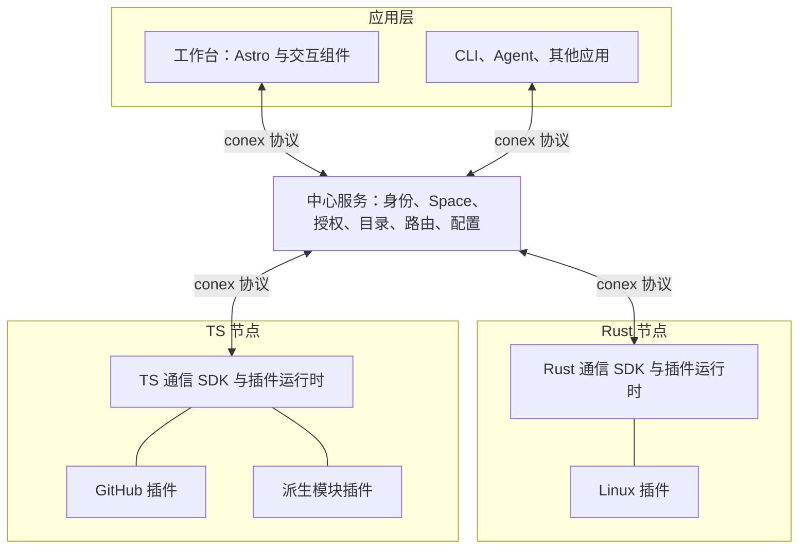

# conex 目标架构

> 状态：目标架构已于 2026-10-17 经用户确认；本文整理该决定，不代表实现已完成。
> 定位：跨设备的能力连接协议，附带 TS/JS 与 Rust SDK、插件运行时和工作台应用。
> 当前拓扑：A，默认中心接入与路由；节点可以同时提供和消费能力，当前不实现 P2P。
> 权威范围：本文取代 [旧设计](2026-09-14-conex-design.md) 的产品定位、目标组件边界与推进顺序。现有 wire 契约继续描述当前实现；目标架构不直接改写线上协议。差异必须通过明确的契约变更和完整调用方迁移处理，不保留两套默认实现或兼容别名。

## 1. 目标与边界

conex 连接分布在不同设备上的服务，让应用发现、消费和组合这些服务提供的能力。工作台是第一个消费者，不是协议的唯一用途。

架构采用以下决定：

1. 能力契约是跨语言协作边界，不远程传递语言对象、闭包或依赖注入容器。
2. SDK 均能提供和消费能力；provider/consumer 是角色，不是两种互斥节点。
3. 本地插件通过生命周期和依赖注入组合；远程能力通过明确的目标绑定访问。
4. 默认中心管理身份接入、工作空间、授权、目录和路由。
5. 组合模块仍通过普通模块契约对外提供能力。
6. 工作台、CLI、Agent 等通过同一协议消费能力，业务模块不依赖页面实现。
7. 凭据保留在明确的执行边界；中心在当前拓扑中是可信的明文路由方，不宣称端到端加密。

第一阶段不建设：P2P、分布式调度、自动模块迁移、插件市场、任意第三方代码在线安装、可视化流程编辑器、Agent 编排、事件溯源系统。大文件续传增强独立推进，不作为状态与插件闭环的前置条件。

## 2. 组件与部署

逻辑分层不要求拆成微服务。默认部署一个中心服务；插件节点可以与中心同机运行，但使用相同的注册、授权和调用边界。中心不获得任意远端插件代码的执行权。

SDK 可嵌入现有进程，不强制每个设备都运行完整 daemon。一台设备可以运行多个节点。浏览器可以通过通信 SDK 消费及提供其权限范围内的能力，但不能加载需要主机权限的插件。

## 3. SICP：原语、组合与抽象

### 3.1 原语

- 身份与标识：主体、节点、工作空间、接入实例、模块、契约和连接标识。
- 能力描述：模块实现的契约、交互方式、输入输出、错误、约束及可用状态。
- 交互：调用、响应、订阅更新、结束、取消。
- 内容引用：指向消息体以外的内容及其访问上下文。

设备类型、GitHub、CPU 和 quota 都不是内核原语。

### 3.2 组合

模块可以依赖本地服务和明确绑定的远程模块。派生模块把输入转换为新的能力，仍用普通契约发布。

例：Linux 状态与 GitHub CI 状态被一个派生模块消费，产生“开发环境就绪”状态；卡片、Rust 程序和后续模块均可使用该状态。

第一阶段用宿主语言代码和配置组合。运行时启动前检查本地依赖缺失与依赖循环；跨节点不做分布式依赖求解，也不承诺发现所有远程循环。远程请求受截止时间和有界资源约束，不因依赖异常无限等待或无限重试。

### 3.3 抽象

契约给能力命名，接入和模块实例给具体提供者命名。消费者面向契约及明确选择的实例，不依赖插件内部对象或连接实现。

组合遵循闭包性质：组合结果可以在相同规则下继续参与组合。不另建只有工作流或页面能理解的输出类型。

## 4. 产品模型与生命周期

| 概念 | 职责与不变量 |
|---|---|
| Principal | 经过验证的用户或节点主体；保留外部身份来源，不按显示名合并身份 |
| Space | 成员、资源共享与授权边界；第一阶段不支持隐式跨空间访问 |
| Node | 运行 SDK 的参与实例；已注册设备节点的稳定身份独立于连接和显示名 |
| Plugin | 经管理员安装的实现包，声明配置、依赖及提供的能力；声明本身不能加载代码或授予权限 |
| Integration | 插件经过配置后的接入实例，有所有者、所属 Space、插件类型及执行节点 |
| Module | 接入实例中可独立发现和使用的功能单元，实现一个或多个明确契约 |
| Contract | 输入输出、交互行为、错误与权限要求的协作约定，不等于某语言的接口对象 |
| Page / Card | 用户保存的页面与卡片配置；卡片绑定具体模块、对象及展示选项 |
| Link | 一次通信连接；重连不产生新的设备注册身份 |

一个插件可创建多个 Integration，一个 Integration 可提供多个 Module，一个 Module 可被多个 Card 或程序消费。第一阶段一个 Integration 只有一个执行节点。

浏览器标签页是临时连接参与实例，不自动成为长期设备注册；用户身份、标签页实例、连接及设备节点标识不能互换。

配置与在线状态分离：

- 节点断线不删除接入、模块绑定或卡片配置。
- 接入停用后不接受新业务调用，并结束其订阅；已经发给外部系统的操作不能保证撤回。
- 删除卡片只删除展示配置，不删除接入或远端资源。
- 同名模块不自动覆盖或接管既有绑定；实例不存在时明确不可用。
- 持久化配置由中心管理；节点报告实际运行状态，中心不能将期望配置当作已经生效。

## 5. 能力与时间语义

### 5.1 状态

状态支持读取快照和订阅更新，包含来源、采样时间及有效性。第一阶段采用“先快照、后更新”的订阅语义；实现必须保证二者之间不静默漏掉当前状态，并能判断快照和更新的先后，不仅依赖跨设备墙钟。

断线后保留最后值时必须标记过期。重新连接重新建立订阅并取得快照，不宣称恢复了中断期间所有变化。节点在线、模块就绪和数据新鲜是三个独立事实。

### 5.2 事件

事件描述已经发生的事情。是否可回放、是否去重及保留范围由契约声明，不能由某种传输的 ACK 推导为业务保证。第一阶段允许无回放的实时订阅，断线后必须暴露中断，不能伪装成连续历史。

### 5.3 操作

操作声明输入、输出、错误、是否有副作用和取消语义。传输送达不等于执行成功；有副作用的操作不得在结果未知时自动重试。只对契约允许、且可证明安全的情况重试。

取消表示请求停止，不保证撤销已经发生的外部副作用。操作回执区分进行中、成功、失败和结果未知；不是简单显示 toast 后丢弃请求关联。

### 5.4 内容

大文件不进入普通 JSON 消息体。能力返回内容引用，访问内容仍需授权；标识和内容地址都不是访问凭据。

范围读取、分块、校验、断点恢复、存储保留和回收属于独立内容契约。当前已有内容实现是否满足这些要求，须按专项验收记录判断，不由本架构声明其已完成。

## 6. 协议与多协议扩展

核心协议负责握手、能力注册发现、实例定位、调用、订阅、取消、错误、内容引用和可信授权上下文，不包含 Linux/GitHub 等领域分支。

两类扩展必须区分：

| 扩展 | 职责 | 示例 |
|---|---|---|
| conex 连接绑定 | 将 conex 交互映射到具体消息与传输 | JSON-RPC/HTTP、WebSocket |
| 外部服务适配器 | 将外部系统映射成模块能力 | GitHub REST、第三方 JSON-RPC、gRPC 服务 |

第一阶段采用 HTTP 与 WebSocket，延续已存在的单一结构类型源和生成管线：`schema/conex/*.proto` 派生 Rust、TS 与 JSON Schema。行为语义单独写入契约与一致性向量，不能仅靠生成类型保证互操作。

新增领域契约不为通用路由添加具体应用分支。自定义插件契约的打包和注册格式在插件专项契约中确定；不同时维护同一数据结构的手写 TS/Rust 定义，也不在本轮引入新的 schema 系统。

增加 gRPC 承载或 P2P 路径需要验证身份、权限、取消及订阅语义，不承诺任意传输可以无损互换。用户访问路由不添加平行的版本前缀；契约兼容性通过明确协商和调用方迁移处理。

## 7. SDK 与插件运行时

### 7.1 通信 SDK

TS 和 Rust 各自提供可嵌入的实现，均支持连接、发现、调用、订阅、取消、提供能力和内容访问。JS 使用 TS 包编译产物；浏览器入口不能隐式依赖 Node.js 主机能力。

仅消费能力的程序无需启动插件运行时。TS/Rust 共享协议和一致性行为，不通过 FFI 强制共用同一运行时，也不要求 SDK 总是连接内置 Host 才可使用其本地组件。

### 7.2 插件运行时

负责配置校验、本地服务注册、依赖解析、启动停止、资源释放、接入与模块生命周期，以及通信 SDK 的能力发布。

本地依赖直接调用，远程依赖以明确的实例绑定访问；配置依赖不等于授予访问权。远程不可用、超时、权限拒绝和结果未知必须向消费者显式表达。

初期插件在受信任进程内运行，故障隔离与安全隔离能力有限。需要隔离的插件部署到独立节点或进程；不把 DI、清单或 Rust 类型安全当作恶意插件沙箱。生命周期接口不承诺任意代码热更新。

### 7.3 数据导向分派

以下是逻辑注册键，不预先要求每张表都成为独立数据库表或抽象层：

- 插件类型键 → 已安装插件工厂和配置契约。
- 契约标识与协商的兼容信息 → 输入输出校验及交互语义。
- Space、接入与模块实例标识 → 已授权、当前有效的提供者绑定。
- 连接绑定标识 → 传输实现。
- 卡片类型键 → 已安装前端渲染器及配置契约。

业务主路径不按 `linux`、`github` 等名字分派。安装与装配层可以注册具体实现；注册冲突明确拒绝，不允许普通节点通过同名声明覆盖其他提供者。

## 8. 中心服务与安全

中心负责身份接入、会话、Space 成员、节点登记与撤销、配置、能力目录、授权、路由、操作回执和审计。中心不是通用分布式任务调度器。

### 8.1 认证与授权

- 外部 OIDC 提供用户认证；外部身份使用 issuer 与 subject 区分，不按邮箱直接合并。
- 节点使用独立凭据，不长期持有浏览器会话。设备登记须经有权用户批准，显示名或自报节点 ID 不能建立身份。
- 用户加入 Space、节点登记、能力发布和资源访问分别授权。
- 节点声明的能力不会自动获得权限；可见目录按调用者权限投影，发现不是授权。
- 中心验证调用者并产生可信调用上下文；提供节点验证来自受信连接的上下文及本地权限上限，不接受调用者自行填写的身份。
- 权限撤销使新调用和新订阅失败，并终止受影响的现有订阅；执行中操作按契约取消，无法保证撤销已发生的副作用。

### 8.2 凭据与配置

中心保存接入配置、执行绑定和凭据引用。秘密值默认保存在执行节点，页面和普通能力描述不返回秘密值。敏感配置采用受控输入路径，不能通过聊天、事件或审计正文传播。

当前中心可以读取经其路由的业务数据，应明确展示该信任边界。未来端到端加密必须另立契约，不能暗中改变中心可读性。

### 8.3 有界运行

消息、队列、并发、订阅数量和内容传输均应有资源上限及取消路径。慢消费者不能导致无限积压；中断必须可观察。审计记录主体、目标、操作及结果，不记录秘密值；记录保留受配置控制。

审批是可按应用增加的产品能力，不为首批只读接入引入通用审批引擎。具有副作用的新插件必须在发布该能力前明确其授权与确认方式。

## 9. 工作台与应用集成

Astro 负责主页、文档、登录入口和应用外壳；交互组件负责实时卡片、布局、配置和操作反馈。本文不额外绑定某个交互组件框架。

前端和后端插件分别安装、通过契约关联：后端提供能力，前端提供渲染和配置。一个契约可以有多种卡片；无专用卡片时可使用通用状态、列表和事件展示。节点不能通过提供任意 URL 让页面执行远端脚本。

添加接入的用户流程为：选择已安装插件 → 选择授权执行节点 → 完成配置和认证 → 发现模块 → 选择模块和对象添加卡片 → 查看状态、订阅或操作结果。

页面和卡片配置持久化在中心，并受 Space 权限保护；只读页面不授予操作权。前端隐藏按钮不是授权。一个模块被多张卡片使用，不要求重复安装或重复配置接入。

CLI、Agent 及其他应用使用同样的能力；不强制把操作编码成聊天命令，也不强制所有结果公开为消息。xMatrix 的聊天与协作文档功能不进入核心。

## 10. 抽象屏障与可加性验收

| 屏障 | 上层知道 | 下层可替换 | 可加性验收 |
|---|---|---|---|
| B0 契约 / 领域实现 | 数据、交互、错误和权限约定 | 采集器及第三方 API 实现 | 新增 GitHub 插件不改通用路由 |
| B1 通信 SDK / 连接绑定 | 调用、订阅、取消和失败 | 合法承载与编码 | 新绑定不改业务模块，逐项证明原语义 |
| B2 模块 / 运行位置 | 契约和明确实例绑定 | 节点地址、连接 | 重连不改模块身份，不改消费者业务代码 |
| B3 卡片 / 数据源 | 契约和展示配置 | 后端实现与宿主语言 | 新卡片不改采集器，换 Rust/TS 实现不改同契约卡片 |
| B4 组合 / 原始模块 | 同样的发现、调用和订阅 | 派生逻辑 | 派生状态能再被普通模块和 Rust 消费者使用 |
| B5 权限 / 发现 | 经过验证的授权结果 | 目录索引和展示分组 | 同名注册、知道 ID 或进入目录不能扩大权限 |

命名只在明确的边界转换：外部身份映射成 Principal；运行配置绑定到具体接入和模块实例；实例再解析到连接。显示名不参与权限判断，不把 Node、Link、用户和卡片 ID 混用。

## 11. 交付切片与验收

这里是交付顺序和行为验收，不是可直接执行的代码修改计划。每个切片实施前需完成对应 wire、生命周期或持久化专项契约及源码影响分析。

### S1：双向协议与 SDK

TS 与 Rust 通过中心互相提供和消费一个真实能力。验证结构互操作、权限拒绝、取消、订阅中断和有副作用调用的未知结果。CLI/脚本直接使用 SDK，不经过工作台。

专项定义见 [S1 双向能力与状态订阅契约](../contracts/s1-capabilities.md)（待评审、未实施）；它明确 JSON WSS 共同提供端路径和 HTTP 消费端边界，不将既有 ACK、通知回调或 agent 进程当作完成证据。

[S1 实施计划](../plans/2026-10-17-conex-s1.md) 给出文件所有权、九个任务与验收依赖，执行状态在 Paca conex 项目维护；S2–S5 只登记路线验收，不以未定实现细节冒充编码计划。

### S2：插件运行时与组合

以已安装的可信插件创建多个接入实例，验证本地依赖、显式远程绑定、缺失依赖拒绝、循环依赖拒绝和停止时释放资源。派生模块按同一能力契约再次发布，可被另一语言消费者使用。

### S3：真实接入

Rust Linux 插件提供 CPU、内存和 SSH 会话统计，明确统计口径和权限需求；TS GitHub 插件提供选定仓库 CI 状态和事件。真实外部凭据仅进入执行侧。quota 接入需先选定供应商及其可用接口，不使用假余额代替。

### S4：身份、节点与 Space

真实 OIDC 登录、设备登记和撤销、Space 成员与资源授权。用两个主体验证跨 Space 拒绝、目录过滤和撤权后的订阅终止；已有 group 加入凭据不能被当作完成 Space 授权的证据。

### S5：工作台闭环

Astro 外壳中创建多个卡片，绑定不同接入和模块，刷新后配置仍在；同模块可被多卡片使用。停止一个节点，其他节点不受影响，其卡片显示离线和过期；节点恢复后取得新快照。另用程序读取同一模块，证明页面不是唯一入口。

S1 至 S3 仅在受限开发环境验收；S4 安全边界完成前不得将新增接入作为公开多用户应用发布。大文件续传增强与未来 P2P 各有独立专项验收，不据此声称本阶段已实现。

## 12. 与现有实现的关系

[迁移盘点](2026-10-17-conex-migration-assessment.md) 区分源码可见、文档声称和目标缺口。该盘点不把接口存在等同于已通过运行验证。

迁移规则：

- 可复用机制先保留，只有通过目标行为验收后才视为完成迁移。
- 应用专有的 hello、分组、共享和展示逻辑不继续扩散进通用 SDK/内核。
- 不因改名重写整个系统，也不把现有 Rust agent 二进制直接宣称为公开 Rust SDK。
- 当前用户、配置和文件不会因架构文档更新而被删除。真正删除旧 API、配置和存储前必须明确调用方迁移和数据处置。
- 旧设计中 Node 专指密文存储/中继节点的含义不再用于新模型；新 Node 是 SDK 参与实例。迁移时明确改动类型和调用点，不能留下两个同名概念。

## 13. 参考与取舍

以下资料于 2026-10-17 阅读，用于产品概念而非实现背书。

| 参考 | 采用 / 调整 | 不采用及原因 |
|---|---|---|
| [SICP](https://sarabander.github.io/sicp/) | 原语、组合、抽象屏障、数据导向；组合结果再次可组合 | 不由抽象方法推出远程透明或现在就需要 DSL |
| [xMatrix Concepts](https://xmatrix.sh/docs/concepts) | 工作空间、机器、稳定身份与运行实例分离；当前状态与工作过程分离 | 不复制 Agent 中心模型或聊天主入口，conex 的对象更广 |
| [xMatrix Connected apps](https://xmatrix.sh/docs/connectors) | 集成同时有状态、事件和操作；配置后发现、订阅、操作回执 | 不让所有能力必须经过聊天，不把某应用审批默认值视为通用保证 |

这里只借鉴产品组织方式。xMatrix 当前代码采用 FSL-1.1-ALv2，不能把参考功能等同于允许无条件复制代码；本设计未复制其实现。
