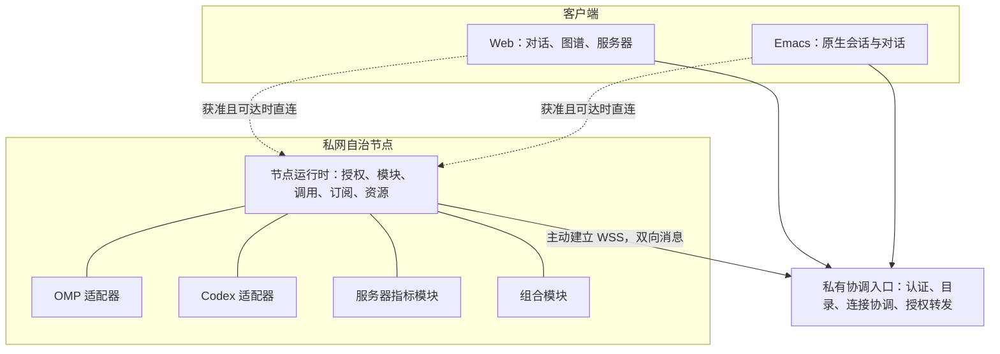

# Conex 私有分布式能力组合平台：MVP 架构基线

> 日期：2026-10-29。状态：用户已确认的目标设计，尚未作为完整产品交付。
> 定位：私有、分布式、可扩展的能力组合平台；首个应用为 Web + Emacs 个人工作台。
> 权威范围：本文取代 [2026-10-17 目标架构](2026-10-17-conex-architecture.md) 的产品定位、目标边界和推进顺序。旧架构与旧迁移盘点保留为历史依据；既有 wire 契约在对应实现切换前仍有效。
> 执行入口：[MVP 实施总计划](../plans/2026-10-29-conex-private-mvp.md)。计划不是交付证据，验收只记录实际运行结果。

## 1. 定位与产品边界

Conex 连接分散在不同设备、不同进程中的能力，让独立模块通过契约被发现、授权、连接、组合，并由不同客户端观察和操作。模块可独立运行，也可声明本地或远程依赖；组合可继续导出普通能力。

首版交付独立程序及应用包，不仅是嵌入式库。应用包描述模块、显式绑定、公共导出、授权要求和部署配置；可以包含自有模块，也可以引用已存在的远程服务。声明不是自动授权，也不隐式执行未获准代码。

MVP 为单用户私有环境：一个用户、多个客户端、多个自治节点。保留节点身份与模块权限，不实现团队、邀请分享、RBAC、多租户账户系统或多用户注册。历史演示的访客、group 和短链接不构成新平台的认证边界。

不是新的 Agent 推理框架、通用运维平台或可视化工作流引擎。Desktop、Mobile 是后续客户端；WASM、热替换、插件市场、任意第三方 UI 在线加载、自动部署、中心 HA、自动 NAT 打洞不属于 MVP。

## 2. SICP：基本元素、组合、抽象屏障

| 思想 | 设计约束 |
|---|---|
| 基本元素 | 具有契约的能力；语言、进程、页面不是能力本身 |
| 组合手段 | 显式依赖绑定、内部封装、公共能力导出；组合不强制写成流程配置 |
| 抽象手段 | 组合能力与原子能力采用同一种消费方式，内部实现不泄漏给消费者 |
| 数据抽象 | 实体、操作、事件具有稳定语义；适配器转换后端结构，不抹平不支持的能力 |
| 定义与求值分离 | 应用包是定义；节点、授权与可用提供者是环境；实例、连接与资源是运行结果 |
| 抽象屏障 | 运行机制、领域契约、适配器和视图分别演化 |

不为采用 SICP 而发明 Lisp、解释器、通用对象图或新 IDL。保留仓库 `schema/conex/*.proto` 的唯一结构类型源及生成链；附件中的 YAML/JSON Schema 是参考，不是批准替换既有类型源。

本地模块内部继续使用普通函数和宿主语言对象，不为每次内部计算套 JSON RPC。跨边界统一契约，不承诺本地与远程调用具有相同延迟、可靠性或事务语义。

## 3. 运行角色与部署

- **协调入口**：私有接入、获准目录、配置、连接协调、可选转发；不是所有模块的父进程。
- **自治节点**：本地认证与授权执行、模块与适配器运行、资源管理、状态和事件恢复；不依赖中心心跳维持本地业务生命。
- **客户端**：查询、展示、用户命令和本地交互状态；不直接持有后端进程生命周期。

角色可以同机部署，不预先按 Manager 数量拆 crate 或微服务。现有 `conex-agent` 是节点侧反连程序，不等于 Agent 领域；迁移优先复用它的部署位置，而非创建第二套默认节点程序。

## 4. 平台扩展边界

| 扩展 | 职责 | 首批实例 |
|---|---|---|
| 领域模块 | 定义稳定概念、操作、事件和错误 | Agent、服务器指标、实体关系 |
| 适配器 | 把具体系统映射到领域契约 | OMP、Codex、Linux 指标采集 |
| 组合模块 | 消费能力后提供新能力 | Agent + 服务器的工作环境摘要 |
| 视图 | 按领域契约组织展示和操作 | 对话、图谱、服务器详情、Emacs buffer |

适配器与视图都依赖领域契约，不彼此依赖。新增具体 Agent 不应要求修改通用路由或每种视图。未知领域类型仍能展示基本描述；不根据任意 Schema 自动承诺生成可用业务界面。

后端可声明支持能力，不向客户端下发任意可执行 UI 代码。首版视图是可信、随客户端构建的扩展；不要求 Web、Emacs 共享组件技术。

## 5. 核心对象与身份

| 对象 | 身份与责任 |
|---|---|
| Principal | 认证后的用户或节点主体，不相信 payload 自报身份 |
| Node | 稳定的执行环境身份，独立于连接与显示名 |
| ModuleInstance | 模块一次运行，带 generation；旧句柄不能接管新实例 |
| Contract | 版本化的操作、数据、事件、错误和约束 |
| AgentEndpoint | 某节点上的 Agent 入口，关联适配器、后端版本和支持能力 |
| Conversation | 持续会话，独立于一次执行和某个客户端连接 |
| Execution | 一次执行活动，关联输入、状态、消息、交互请求和派生执行 |
| Workspace | 节点上的工作环境；路径相同不代表同一 Workspace |
| InteractionRequest | 审批、选择或补充输入请求，具有目标执行、作用域和有效状态 |
| Scope | 本地所有权、清理和访问边界，不是一棵跨机器同步关闭树 |

Conex 标识与后端标识显式映射并保留来源，不按名称合并。MVP 使用仓库既有 ULID 标识惯例；具体 wire 字段及作用域在专项契约冻结后生成。本文的领域对象名不自动变成新 RPC 方法。

稳定对象可跨进程重启保留；运行实例有新代际。Conversation 恢复不意味着旧 Execution、请求或资源句柄复活。客户端不能通过传入任意后端会话文件路径取得控制权。

## 6. 三种图与状态

1. **描述关系图**：运行于、关联 Workspace、参与会话、派生执行、用户标注；记录来源、更新位置及当前/过期/历史状态。
2. **能力绑定图**：谁经哪个契约使用哪个提供者，需单独授权；依赖关系不是生命周期所有权。
3. **传输连接图**：当前经直连还是转发、是否可达；改变路径不改变业务关系或授权范围。

关系来源区分后端报告、Conex 配置与用户标注。Subagent 可映射为带身份的 Agent 与派生 Execution，取决于后端信息；无信息就未知，不通过聊天文本猜测。

Tags 首版是标注，可投影成图节点；status 属于实体。连接不可达、状态过期、执行失败和结果未知分别表达。图谱视图不是唯一数据源，不以使用图谱为由引入图数据库。

## 7. Agent 操作、并发与人工交互

最小共同操作：发现入口和能力；列出/创建/读取/继续会话；提交输入；查询执行；请求取消；列出和回答交互请求；获取快照和订阅事件；读取 Workspace 与派生关系。

执行中追加指令、fork、单独取消 subagent 等通过能力声明开放。不支持就返回明确错误并调整 UI，不伪造成功。

- 同一会话首版最多一个顶层执行；忙碌时明确拒绝新提交，不隐式排队。后端自行派生的并发执行单独建模。
- 提交后获得可查询的执行引用。提交操作的重试需明确幂等键及作用域；默认不自动重发副作用操作。
- 消息结束、输入请求处理结束和整个执行静止不同。OMP 后台工作仍可继续，不能见到一条完成消息就释放执行槽。
- 取消访问请求只表示不再等待；取消 Agent 执行是另一个明确操作。取消已请求不等于后端已停止。
- 断线、超时后不能把后端活动判定为失败；状态未知时拒绝可能冲突的新顶层执行，直到核对或明确终止。
- InteractionRequest 使用一次性状态转换；多端竞答只有一个有效结果，重复/过期回答不重复执行。断线不自动同意审批。
- Conex 访问授权与 Agent 工具审批分层；不得用默认自动批准完成适配。

## 8. 快照、事件与恢复

领域事件包括消息开始/增量/完成、执行状态、交互请求创建/解决/失效、实体关系变化。每个可恢复序列有明确作用域、位置和保留范围，不建立全局事件总序。

1. 客户端获取带版本或游标的快照。
2. 从该边界接续事件，处理快照与增量之间的竞态。
3. 相同事件去重；缺口、越界和失去恢复能力显式返回 resync-required 类结果。
4. 重新同步不把旧命令再执行一次。传输 ACK 不等于业务完成。

状态快照更新与消息增量分开。现有 S1 完整状态订阅和 P1 流重放是候选机制，不构成已实现持久会话事件日志的证据。后端无法补读时记录缺口，不声称无损恢复。

两个客户端共享服务端确定的会话顺序、执行状态与审批结果。草稿、光标、滚动等是客户端本地状态。

## 9. 所有权与生命周期

| 资源 | 默认所有者 | 关闭客户端时 |
|---|---|---|
| 节点创建的 OMP/Codex 进程 | 节点 | 不停止 |
| 外部 Codex app-server | 外部系统 | 不停止服务 |
| 客户端订阅 | 客户端会话/连接 Scope | 释放 |
| 组合创建的实例 | 组合的本地 Scope | 由显式停止组合释放 |
| 外部能力绑定 | 绑定发起者 | 仅解除连接/订阅，不销毁远端模块 |

本地 Scope 关闭先拒绝新增资源，再取消自有任务、撤销发布/订阅并清理；异步释放显式完成，设置截止时间。不能通过 Drop 承诺跨机器可靠清理。

模块生命周期、对中心发布的生命周期、通信连接生命周期必须拆开。断开中心只撤销相应连接/发布状态；本地活动继续，重连后新注册代际与旧远程引用明确区分。远程依赖失效按声明降级或拒绝对应操作，不拖垮无关模块。

应用启动前检查本地必需依赖缺失与环；远程依赖不做跨机器事务或全图启动排序。独立模块可独立部署，按职责而非每个操作拆分。

## 10. 网络、安全与离线语义

### 10.1 私网接入与访问路径

私网节点作为客户端主动建立 WSS 双向连接，不要求开放公网入站端口。工作台也可在私网可达时直接访问节点。直连并不自动意味着私网限定，需要监听地址、网络部署和访问策略共同落实。

导出能力有两种策略：`direct-only` 与 `relay-allowed`。前者约束调用、订阅、内容同步及中心存储；不得绕道聚合模块泄漏原始受限数据。派生模块导出时须明确获准的数据范围，不能以“已聚合”为由绕过来源约束。

公网入口仅转发已发布且获准的 Conex 能力，不接受任意私网 URL/端口，不是通用隧道。路径改变不扩大授权。传输中断后不能自动换路径重发可能已执行的操作。

### 10.2 身份与授权

客户端和节点分别认证，凭据不进入 URL、目录、聊天内容或日志。节点验证目标、方法、资源、调用者、授权有效期和代际；不相信请求体自报 Principal。入口接入凭据不自动授予所有能力。

授权需有范围、有效期和撤销能力。具体凭据格式、轮换及配置入口在网络专项契约冻结，并使用已有安全库，不自制签名算法。持有有效授权和可用地址的已知节点可继续直连；依赖中心续权的授权到期后不能续期则拒绝新调用。

无法同时保证断开中心仍可调用和中心撤权立即全网生效。节点立即执行本地已知撤权；中心撤权在网络分区下存在到授权到期为止的窗口。

历史访客免认证默认值不能进入新私有产品入口；历史演示另有明确用途，迁移不静默公开私有数据。

能力授权和子进程边界不等于 OS 沙箱。MVP 只装配用户明确允许的可信模块与适配器，保留后端原有沙箱/审批约束；不承诺同进程模块或普通子进程无法访问宿主资源，不加载任意不可信代码。真正的不可信代码隔离需由后续受限 WASM 或 OS 沙箱实现。

### 10.3 故障区分

| 情况 | 结果 |
|---|---|
| 中心离线 | 本地模块与有效直连继续；该中心转发中断，不能新发现/续权 |
| 节点不可达 | 客户端显示过期/未知；不能据此断言进程停止 |
| 模块停止/换代 | 撤销对应发布和句柄，旧绑定明确失效 |
| 操作跨越发送边界后失联 | 可能结果未知；不自动重试 |
| 慢消费者 | 有界缓冲、显式终止或要求重同步，不静默丢弃后伪装连续 |

公网转发入口是受信组件，能接触转发明文；TLS/WSS 不等于端到端加密。首版不承诺 E2EE。日志默认不记录正文、路径敏感细节、凭据或审批秘密。

## 11. 持久化与数据归属

MVP 选择 SQLite，协调入口与节点分别持有自己的数据库，不共享跨机器 SQLite 文件，不做分布式数据库。

| 位置 | 保存范围 |
|---|---|
| 协调入口 | 节点/能力目录、授权配置、应用定义、允许同步的关系与标注 |
| 节点 | 后端 ID 映射、执行/交互状态、必要恢复事件；受限权限存储 |
| 原 Agent 系统 | 原生会话、文件及 Workspace 数据 |
| 客户端 | 非权威缓存、本地草稿与交互状态 |

中心默认不持久化完整对话正文；转发期间可在有界内存中处理，禁止通过日志、错误转储或通用重放缓存变相持久化。节点与后端提供历史及恢复，不能保证节点离线时中心仍有完整聊天历史。

节点事件保留量、时间与清理均需有上限；实际值通过专项契约与测量确定，不以“无限日志”换恢复承诺。断电恢复后未确定执行保持未知并核对后端，不能直接当成可重发。标签、关系与应用配置有唯一所有者：节点拥有的内容在节点编辑，中心只保存获准投影；用户中心标注独立存储并标记来源，不跨库双主写。

## 12. 多前端与适配器边界

### 12.1 客户端

- **Web**：Agent/会话列表、创建与继续、流式对话、取消、审批、Workspace、Tags、status、派生关系图谱、服务器指标。
- **Emacs**：原生会话列表及对话 buffer、流式回复、取消、审批/输入、最小 Workspace 选择与派生信息文本。首版不做图形布局和服务器指标面板，不依赖 EAF/ETAF 才能使用。
- **Desktop/Mobile**：后续客户端，复用领域协议，不承诺复用全部 Web 组件。EAF/ETAF 可在客户端层选用，不反向影响内核。

保留现有 React/Bun 前端的可复用部分，不因旧方案写过 Astro 而强制迁移构建框架。首版是否需要引入具体图谱库由实际布局需求决定，不先建通用卡片市场。

### 12.2 后端

- **OMP**：首版完整主路径由节点启动 RPC 进程；一个进程的活动会话约束由适配器处理，并发会话需隔离执行容器，不能让多端互抢同一个活动会话。
- **Codex**：由节点创建或连接 app-server；分别记录自有/外部生命周期责任。
- **已有 OMP TUI**：独立调查 Collab 等可用附着路径。恢复同一历史文件不是接管原运行实例；未验证前不声称支持。
- **指标**：首版覆盖实际部署 Linux 节点的 CPU、内存和磁盘基础指标，携带采样时间；后续通过适配器扩展操作系统。不伪造不支持平台的数据。

协议能力按后端版本协商或探测；Codex 实验 API 和 OMP 方言扩展不能无条件成为所有后端必需项。模型凭据留在节点/原系统，客户端不接收它们。

## 13. 现有实现复用与迁移原则

| 范围 | 可复用机制 | 必须调整 |
|---|---|---|
| Host ModuleRegistry | 静态批准、注册代次、目录投影 | 新私有身份及路径权限，不能等同节点侧离线授权 |
| CallRouter | 截止时间、固定代际取消、未知结果、不自动重放 | 同一领域能力支持节点本地执行与直连，不只中心转发 |
| StateRelay | 快照先于更新、有界队列、终止清理 | 完整状态不等于可恢复消息事件流 |
| TS/Rust plugin | 显式依赖、启动排序、派生再发布 | 现有断线 broken 清理不能直接用于自治节点 |
| conex-agent | 主动连出、认证、重连、受限本地执行 | 通用节点生命周期与 Agent 领域适配器分离 |
| React 工作台 | 通用交互和组件 | 从 hello/share 业务入口切换为领域客户端，不向旧大 hook 追加 Agent 分支 |
| P1 流及内容 | 有界流控、顺序、现有内容机制 | 不假定进程内重放已实现持久对话恢复 |

不整仓重写，不提前建立空包。不因设计更新删除现有用户数据、文件共享能力或历史证据。实际切换按工作包迁移全部受影响调用方、配置和测试，移除被替代默认路径，不留永久双版本或兼容别名。

## 14. MVP 验收矩阵

| ID | 必须观察到的结果 |
|---|---|
| A01 | 单用户私有入口拒绝匿名/错误凭据；节点认证与客户端身份不能伪造 |
| A02 | 两台机器的私网节点主动 WSS 接入；私网无入站端口仍可经公网入口访问获准能力 |
| A03 | 同一契约经直连与转发运行；direct-only 的调用、订阅和中心持久化均被阻止 |
| A04 | 中心停止后本地执行及有效直连继续；转发明确失败；恢复后重新发布且旧代际不接管 |
| A05 | OMP 真实创建/继续会话、流式输出、取消和人工交互，节点不默认自动批准 |
| A06 | Codex 自有/外部 app-server 的真实会话、流式、取消和人工交互；停止适配器不误杀外部服务 |
| A07 | 同会话并发提交明确 busy；多端有效审批只处理一次；请求超时不被误报为执行停止 |
| A08 | Web 完整对话，Emacs 原生列表/对话/流式/取消/审批/Workspace；两端状态一致 |
| A09 | Agent、Conversation、Workspace、Tags、status、Node 和后端支持的 subagent 关系可查；关系有来源，未知不伪造 |
| A10 | Web 图谱/对话/服务器视图关联相同身份；关系线不授予权限 |
| A11 | 节点断线显示过期；重连续接或明确 resync；重复不重复显示，缺口不静默丢弃 |
| A12 | 取消与终结竞态仅一个终态；副作用失联为结果未知，不自动换路或重连重发 |
| A13 | 关闭任一客户端不停止外部 Agent；停止组合只释放自有资源，不影响无关实例 |
| A14 | Agent + 服务器摘要模块依赖真实能力，再发布普通能力，被另一个消费者使用 |
| A15 | 进程重启后配置/标注/会话映射恢复；未知执行先核对；中心磁盘与日志不含测试对话正文/凭据 |
| A16 | 有界事件/队列下慢消费者明确终止或重同步，授权过期/本地撤权拒绝后续访问 |

MVP 只有 A01–A16 全部取得对应真实证据才算交付；后续功能不能挤掉已确认项目。已有源码、历史验收和元数据握手均不代替这张表的产品验收。

## 15. 调查证据与未验证边界

2026-10-29 本机会话实际观察：OMP 18.13.2 隔离 RPC 收到 ready，get_state 成功；Codex 0.163.0 app-server initialize 成功；现有 TS 插件对缺失本地依赖在连接前返回 missing_dependency 并进入 failed。未调用模型，未验证真实对话、取消、审批、附着已有实例、私网/公网或前端交互。

源码定位：[注册表](../../crates/conex-host/src/capability/registry.rs)、[调用路由](../../crates/conex-host/src/capability/calls.rs)、[状态中继](../../crates/conex-host/src/capability/state.rs)、[TS 插件](../../sdk/typescript/src/plugin.ts)、[Rust 插件](../../crates/conex-sdk/src/plugin.rs)、[反连程序](../../crates/conex-agent/src/runtime.rs)。历史 S1/S2 证据见 [S1](../verification/s1-capabilities.md)、[S2](../verification/s2-plugins.md)，不当作本轮重跑。

外部协议参考：[Codex App-server](https://developers.openai.com/codex/app-server)。OMP 以安装包随附的 `rpc.md`、会话和 Collab 文档及对应版本源码为准；安装内 URI 不作为其他读者必须可访问的普通网页。协议版本差异通过首个工作包探针确认，不能把最新在线文档视为本机全部支持。

该外部参考于 2026-10-29 实读可达，重定向至 ChatGPT Learn 的 App-server 文档；可达性不代表其全部字段适用于当前安装版本。
